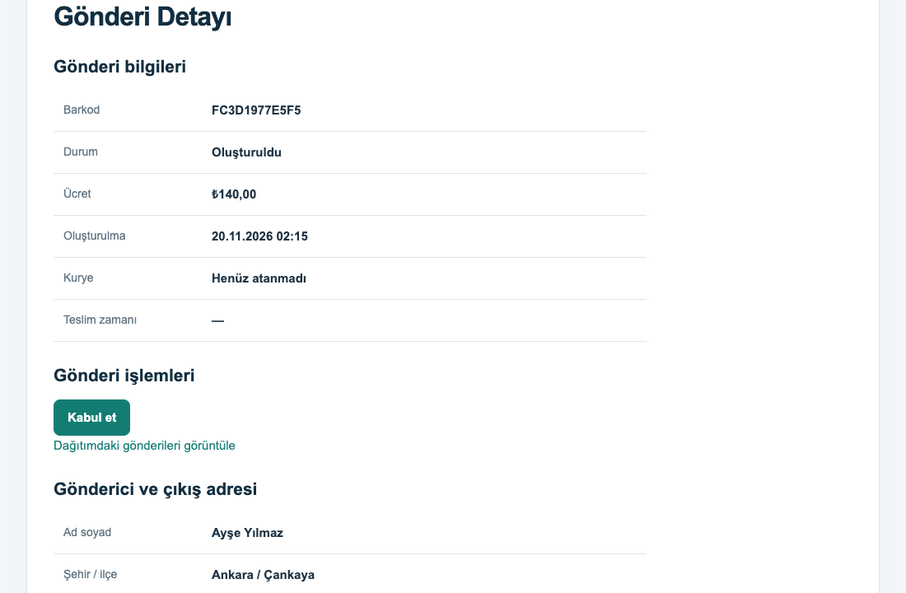
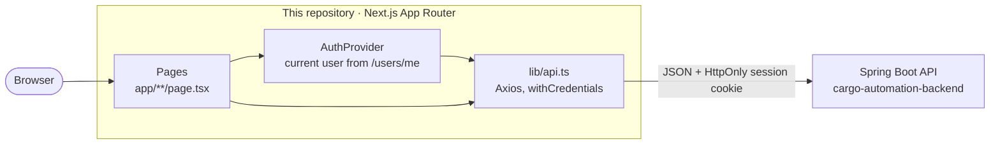

# Cargo Automation Frontend

Next.js frontend for a cargo automation project. The interface supports customer shipment creation and tracking, staff shipment operations, and admin staff management and reports.

Backend: [cargo-automation-backend](https://github.com/MirayBozdogan/cargo-automation-backend).

## Preview

<p align="center">
  
</p>

<p align="center"><sub>A customer creates a shipment, an admin moves it from acceptance to delivery, and the customer tracks the result. Recorded with fictional demo data.</sub></p>

## Architecture



Pages are client components that call the backend through one Axios instance. The browser attaches the session cookie; a `401` clears the local session marker and returns to login. Roles only decide which links are shown; the backend makes every authorization decision. The backend architecture and shipment lifecycle diagrams are in its [README](https://github.com/MirayBozdogan/cargo-automation-backend#architecture).

## Technologies

Next.js 16.4.5, React 19.2.8, TypeScript, Axios and CSS. Tests use Vitest and React Testing Library. Dependency versions are recorded in `package-lock.json`.

## Run locally

Use Node.js 20.19 or newer, npm and Git. Start the backend first; the quickest way is its [Docker setup](https://github.com/MirayBozdogan/cargo-automation-backend#quick-start-with-docker).

```sh
git clone https://github.com/MirayBozdogan/cargo-automation-frontend.git
cd cargo-automation-frontend
npm ci
npm run dev
```

Open `http://localhost:3000`. The API client in `lib/api.ts` uses `NEXT_PUBLIC_API_URL`, or `http://localhost:8080` when it is not set. To use another backend address, copy `.env.example` to `.env.local`, change the value and restart `npm run dev` (the value is built into the bundle). The backend permits the frontend origin through its `CORS_ALLOWED_ORIGINS` setting (default `http://localhost:3000`); if the frontend runs on another port or host, add that origin there too.

There is no default shared account. Customers register through Kayıt Ol. To use admin/staff screens, create the first local admin using the backend's development initializer and then add staff through Personel Yönetimi.

## Screens and roles

| Screen | Route | Access / behavior |
| --- | --- | --- |
| Login / registration | `/`, `/register` | Public; registration creates a customer |
| Password reset | `/forgot-password`, `/reset-password` | Public; request a reset link and set a new password with it |
| Change password | `/profile/password` | Signed-in account; requires the current password |
| Profile | `/profile` | Current account; entry point to Adreslerim |
| Addresses | `/addresses` | Own address list and creation |
| Own shipments | `/users/{id}` | Current user's sent/received shipments, dates and prices |
| Shipment creation | `/shipments` | Own shipment, manual recipient and price preview |
| Tracking | `/tracking` | Barcode lookup for own sent/received shipments |
| Customers | `/users` | Staff/admin search and Adına gönderi oluştur link |
| Shipment operations | `/operations` | Staff/admin list, status filter and delivered shortcut |
| Operation detail | `/operations/{id}` | Accept, prepare, assign courier and permitted delivery |
| Out for delivery | `/deliveries` | Staff/admin list of shipments in distribution |
| Staff management | `/staff` | Admin creation, editing and activation/deactivation |
| Reports | `/reports` | Admin total, delivered and per-status shipment counts |

Staff/admin create a shipment for a customer from Müşteriler → Adına gönderi oluştur. This opens the same shipment form with the selected customer and permitted addresses. Customers do not see the customer, operation, staff or report management links.

Profilim → Bilgilerimi düzenle opens the own-profile edit route `/users/{id}/edit`. It sends only editable fields. An email change requires signing in again because the JWT subject is the email.

Profilim → Şifremi değiştir opens `/profile/password`. The form asks for the current password and the new password twice; the repeat field is checked in the browser and is not sent. The backend ends the account's sessions on other devices and sends a new session cookie, so the user stays signed in on this one.

## Shipment flow

```text
Oluşturuldu → Kabul edildi → Dağıtıma hazır → Dağıtımda → Teslim edildi
```

The backend controls transitions, ownership, pricing and permissions. The UI shows the available actions for the current state. A courier is an active staff member; the assigned courier or admin can record delivery. A customer can delete a sent shipment only before acceptance. Delivered shipments and their timestamps remain visible in the own-shipment list; the separate delivered filter belongs to the staff/admin operations list.

The price preview uses the backend calculation, and saving recalculates the price. Times are displayed in the Europe/Istanbul timezone. Loading, empty and retry/error views are included; wide tables scroll horizontally on small screens.

## Authentication

The backend stores the JWT in an `HttpOnly` cookie on login, so page JavaScript cannot read it; the Axios client sends it with `withCredentials`. The browser keeps only a non-secret `signedIn` marker in localStorage to skip the session check for visitors who never signed in. The shared AuthProvider reads `/users/me` for the current account and role. A rejected/expired session clears the marker and returns to login; Çıkış yap asks the backend to expire the cookie. Server-side authorization remains authoritative even when a menu link is hidden.

Şifremi unuttum on the login screen opens `/forgot-password`. It always shows the same message, whether or not the address has an account. The emailed link opens `/reset-password?token=...`; the link is valid for 30 minutes and only once, and a successful reset ends every open session of the account. Locally the emails are caught by Mailpit (see the backend README). There is no email-verification flow in the current version.

## Checks and production build

```sh
npm test
npm run lint
npm run build
npm run start
```

`npm test` runs the Vitest unit tests once (`npm run test:watch` keeps them running). They cover the API client's cookie/401 handling, the session marker, login, logout and the profile screen; they do not start the backend.

The default build uses Turbopack. `npm run start` serves the compiled frontend on port 3000; keep the backend running separately. The backend's automated tests and isolated test command are documented in its repository.

To inspect dependency advisories for your installed lockfile:

```sh
npm audit
npm audit --omit=dev
```

On 8 November 2026, `npm audit --omit=dev` reported no advisories; the full audit reported 8 moderate findings in the development lint dependency chain. No high or critical findings were reported. Audit results can change as new advisories are published; these checks are not a complete security assessment.

## First-version scope

Customer registration, addresses, shipment creation, staff acceptance/preparation/courier assignment/delivery, customer tracking and admin staff/report screens are implemented. Branch transfers, returns, redelivery, failed delivery, payments, SMS and maps are outside this version.

## Author

Miray Bozdoğan · Computer Engineering Student

[GitHub](https://github.com/MirayBozdogan) · [LinkedIn](https://www.linkedin.com/in/miraybozdoğan)
